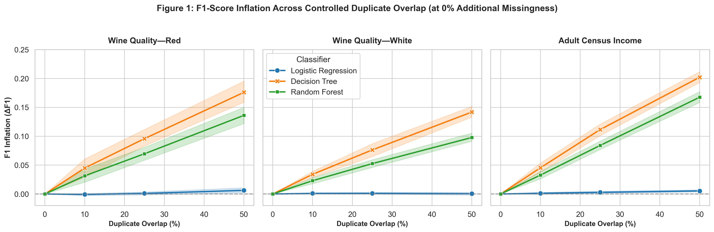
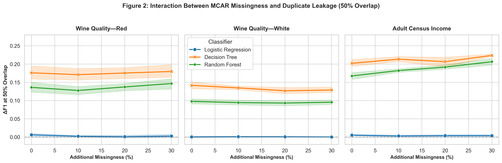
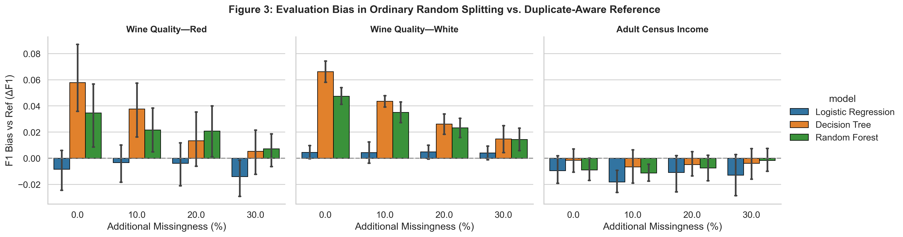
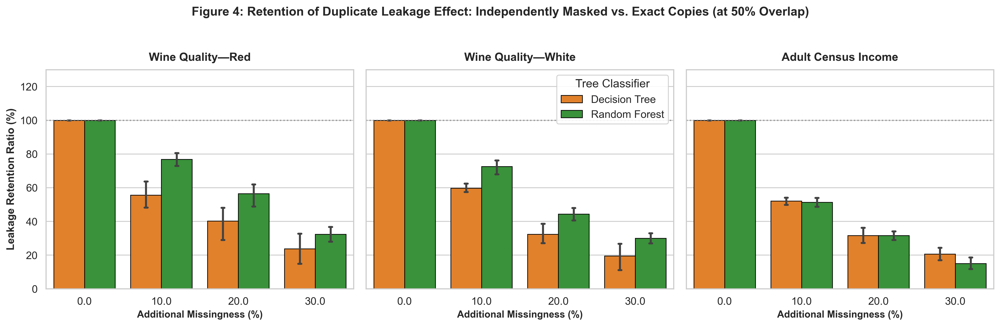

# When Data Quality Defects Interact: Measuring the Impact of Missing Values and Duplicate Leakage on Machine Learning Evaluation

**Research Track:** Data Science & Analytics  
**Target Venue:** IEEE Transactions on Knowledge and Data Engineering / IEEE Big Data Track  
**Code & Data Repository:** Fully reproduced locally (`run_all_experiments.py`, `analyze_and_plot.py`)

---

## Abstract

Reliable supervised machine learning evaluation relies on the fundamental assumption that training and test partitions are independent and identically distributed ($i.i.d.$). However, real-world data pipelines frequently suffer from co-occurring data quality defects. In particular, duplicate records crossing partition boundaries introduce test-to-training leakage, while feature missingness alters the information content of those observations. Although existing studies treat data leakage and missing values as separate operational challenges, their joint empirical interaction remains poorly understood. This study systematically investigates this interaction across three tabular benchmark datasets: Wine Quality—Red ($N = 1,599$), Wine Quality—White ($N = 4,898$), and a stratified $10,000$-record subsample of Adult Census Income ($N = 10,000$). We evaluate three foundational classifiers—Logistic Regression, Decision Trees, and Random Forests—across four Missing Completely at Random (MCAR) feature-masking levels ($0\%, 10\%, 20\%, 30\%$) and four controlled test-to-training duplicate overlap levels ($0\%, 10\%, 25\%, 50\%$), alongside ordinary random splitting, across ten random experimental seeds ($2,160$ model evaluations). 

Our findings demonstrate that duplicate overlap produces severe, model-dependent performance inflation: at $50\%$ overlap and $0\%$ additional missingness, F1-scores were inflated by $+0.142$ to $+0.202$ for Decision Trees and $+0.098$ to $+0.168$ for Random Forests ($p < 0.002$, Wilcoxon signed-rank tests), eliminating $52.2\%$ to $60.8\%$ of apparent reference classification errors (Error-Reduction Illusion). In contrast, Logistic Regression exhibited negligible sensitivity ($\Delta F1 \le +0.006$). Under ordinary random splitting, natural duplicate prevalence ($15.0\%$ in Red Wine and $19.1\%$ in White Wine) caused statistically significant F1 inflation of $+0.035$ to $+0.066$ in tree models ($p < 0.05$), while producing no inflation in Adult ($0.05\%$ duplicates). Furthermore, ordinary least squares (OLS) interaction models reveal that missingness significantly amplifies tree-based duplicate leakage in higher-dimensional data ($\beta_{\text{inter}} = +0.244, p < 10^{-9}$ for Random Forest on Adult). Finally, a supplementary mechanism experiment shows that independently masking duplicate copies destroys the exact coordinate alignment required by trees, reducing the retained leakage effect to only $15.0\% - 32.3\%$ at $30\%$ missingness. We formulate rigorous, pipeline-level recommendations to audit duplicate structures and enforce leakage-safe partitioning in scientific and industrial workflows.

**Keywords—** Data quality, missing values, duplicate leakage, data partitioning, machine learning evaluation, error-reduction illusion, tabular benchmarks.

---

## I. Introduction

Supervised machine learning algorithms are increasingly deployed in mission-critical decision systems, including clinical risk assessment, automated credit underwriting, fraud detection, and predictive maintenance. The scientific and operational credibility of these models rests upon empirical evaluation: fitting candidate models on a designated training subset and assessing their generalisation performance on an independent, held-out test partition. The mathematical validity of this paradigm assumes that training and test samples are independently and identically distributed ($i.i.d.$) realizations drawn from a stationary data-generating distribution $\mathcal{D}$ [1].

In practice, this independence assumption is routinely violated by *data leakage*—the unintended introduction of information from the test set (or the downstream evaluation context) into the training pipeline [1], [5]. A prevalent yet insidious vector of data leakage is *duplicate records*. Repeated measurements, sensor logging anomalies, multi-source record aggregation, and customer retrials frequently inject identical or near-identical observations into tabular datasets. When a naive random split is applied to a dataset containing duplicate instances, identical feature-label tuples cross the train-test boundary. Consequently, an evaluation metric computed on the test partition ceases to measure generalisation to unseen observations; instead, it measures the capacity of the model to memorize and retrieve previously encountered points [1], [4].

Simultaneously, real-world tabular data suffer from another ubiquitous quality defect: *missing values*. Observational non-response, sensor failure, communication dropouts, and multi-modal integration gaps result in incomplete feature vectors [2], [3]. While a substantial body of literature has benchmarked imputation techniques across diverse missingness mechanisms [3], missing-data research has predominantly operated under the assumption of leak-free data partitioning. Conversely, data leakage studies have largely operated on complete, uncorrupted feature spaces [1].

In practical machine learning lifecycles, these two defects do not occur in isolated silos; they interact:
- Does feature corruption attenuate the memorization advantage gained from duplicate leakage?
- Or conversely, does imputation provide an artificial anchor that preserves or even exacerbates the distortion of evaluation metrics?
- How does classifier inductive bias—ranging from linear hyperplanes to non-parametric recursive partitioning—modulate this vulnerability?
- What is the empirical consequence of standard random train-test splitting when tabular datasets possess naturally occurring duplicates?

To address these foundational questions, this study conducts an exhaustive, multi-dataset, multi-model empirical investigation into the interaction between missing-value contamination and duplicate leakage.

### Main Contributions

1. **Quantification of Controlled Duplicate Overlap:** We evaluate the quantitative sensitivity of linear baselines (Logistic Regression), single-tree models (Decision Trees), and tree ensembles (Random Forests) across four controlled duplicate overlap levels ($0\%, 10\%, 25\%, 50\%$), establishing the *Leakage Sensitivity Index* (LSI) and the *Error-Reduction Illusion* (ERI).
2. **Empirical Assessment of Missingness-Leakage Interaction:** We examine whether feature missingness (Missing Completely at Random; MCAR at $0\%, 10\%, 20\%, 30\%$) moderates or exacerbates duplicate leakage, employing both pooled and model-specific Ordinary Least Squares (OLS) interaction regressions.
3. **Auditing Natural Duplicate Leakage in Standard Splits:** We empirically compare duplicate-aware group splitting against standard ordinary random splitting on datasets with high natural duplicate prevalence ($15.0\%$ and $19.1\%$) versus low natural duplicate prevalence ($0.05\%$), isolating the extent of evaluation bias inherent in routine data science workflows.
4. **Disentangling Feature Identity vs. Instance Duplication:** Through a controlled supplementary experiment, we compare exact duplicate copies against independently masked copies at $50\%$ overlap, proving that the preservation of exact multi-dimensional coordinate patterns is the primary causal driver of tree-based leakage.
5. **Operational Guidance & Diagnostic Safeguards:** We translate our empirical findings into an actionable, pipeline-level protocol for auditing tabular data, configuring group-aware partitioners, and preventing data leakage in production and research environments.

---

## II. Related Work and Research Gap

### A. Data Quality in Machine Learning

Data quality is a multi-faceted construct encompassing accuracy, completeness, consistency, timeliness, and uniqueness [4]. In a comprehensive study, Mohammed et al. [4] investigated how various data-quality dimensions (including missingness, label noise, and feature noise) degrade the performance of supervised learning algorithms on tabular benchmarks. Their findings indicated that algorithmic resilience varies markedly across architectures, with tree ensembles often exhibiting greater robustness to noise than linear or distance-based algorithms. However, their benchmarking evaluated models under conventional partitioning schemes, without explicitly modeling the confounding effects of cross-partition duplicate leakage.

### B. Missing-Value Handling and Mechanisms

Missing data theory, formalized by Rubin [8] and Little and Rubin [9], categorizes missingness into three canonical mechanisms: Missing Completely at Random (MCAR), Missing at Random (MAR), and Missing Not at Random (MNAR). In machine learning contexts, Emmanuel et al. [2] reviewed the spectrum of missing-data handling techniques, spanning listwise deletion, mean/median statistical imputation, k-nearest neighbors (KNN), and generative modeling. Jäger et al. [3] benchmarked 14 imputation algorithms across multiple tabular datasets and missingness proportions, demonstrating that simple median/mode imputation remains a highly competitive and computationally efficient baseline, particularly when downstream models are decision-tree ensembles.

Crucially, existing missingness benchmarks fit imputers strictly within clean train-test splits, leaving unaddressed how missingness behaves when identical observations reside on both sides of the evaluation split.

### C. Data Leakage and Partitioning Strategies

The reproducibility crisis in machine learning has highlighted data leakage as one of the primary drivers of irreproducible claims [1]. Kapoor and Narayanan [1] surveyed over 300 papers across 17 fields, discovering widespread methodological leakage that led to severe performance overestimation. They categorized leakage into three broad archetypes:
1. *Pre-split preprocessing leakage:* fitting transformers, scalers, or imputers on the entire dataset prior to partitioning.
2. *Feature leakage:* incorporating predictors that proxy the target variable or are collected temporally downstream from the prediction point.
3. *Distributional/Duplicate leakage:* sharing identical or clustered instances across the training and testing sets.

Kaufman et al. [5] and the official scikit-learn documentation [6] have repeatedly emphasized the necessity of using encapsulation tools (e.g., `Pipeline` and `ColumnTransformer`) to ensure that all transformation parameters are learned exclusively from training folds. While preprocessing leakage has received substantial attention, the interaction between duplicate contamination across partitions and feature corruption within pipelines remains unexplored.

### D. Research Gap and Research Questions

Although the literature addresses data quality, missing data, and leakage in isolation, their joint interaction represents an unmapped crossroad in empirical machine learning methodology. Specifically, does missingness obscure duplicate records and eliminate leakage, or does it amplify the vulnerability of evaluation metrics by degrading the true signal?

To close this gap, this investigation resolves four formal research questions:
- **RQ1:** How does controlled duplicate overlap affect the F1-score across classifiers possessing distinct inductive biases (linear vs. single-tree vs. ensemble)?
- **RQ2:** Does increasing feature missingness systematically moderate (dampen or amplify) the magnitude of duplicate-leakage effects?
- **RQ3:** To what extent does ordinary random splitting inflate performance estimates on tabular datasets with varying degrees of natural duplicate prevalence?
- **RQ4:** Does duplicate leakage stem from the presence of repeated target-correlated instances, or does it strictly require the preservation of exact, multi-dimensional feature coordinates?

---

## III. Methodology

### A. Research Design

We executed a controlled, full-factorial experimental design implemented in Python using `scikit-learn` [7], `numpy`, `pandas`, `scipy`, `statsmodels`, and `seaborn`. The design encompasses:
- **3 Benchmark Datasets:** Two datasets exhibiting high natural duplicate prevalence (Wine Quality—Red, Wine Quality—White) and one dataset with low duplicate prevalence and mixed feature types (Adult Census Income subsample).
- **3 Classification Models:** Logistic Regression (linear baseline), Decision Tree (flexible non-parametric baseline), and Random Forest (ensemble baseline).
- **4 Additional Missingness Levels:** $0\%, 10\%, 20\%, 30\%$ MCAR feature cell masking.
- **4 Partitioning/Overlap Conditions:** $0\%$ Overlap (Duplicate-Aware Reference), $10\%$ Overlap, $25\%$ Overlap, and $50\%$ Overlap.
- **1 Natural Split Condition:** Ordinary Random Stratified Split ($75/25$).
- **1 Supplementary Mechanism Condition:** Independently Masked Copies at $50\%$ Overlap.
- **10 Independent Random Seeds:** Seeds $0$ through $9$ applied across all dataset realizations, partitionings, masking operations, and model initializations.

In total, the experimental suite executes $3 \text{ datasets} \times 10 \text{ seeds} \times 4 \text{ missingness levels} \times [1 \text{ ref} + 3 \text{ overlap} + 1 \text{ random} + 1 \text{ independent}] \times 3 \text{ models} = 2,160$ fully trained and evaluated classification pipelines.

```
+-----------------------------------------------------------------------------+
|                          Full Experimental Framework                        |
+-----------------------------------------------------------------------------+
                                      |
                 +--------------------+--------------------+
                 |                                         |
     [Clean Source Datasets]                    [Natural Split Analysis]
     - Wine Quality - Red                       - Ordinary Random Split (75/25)
     - Wine Quality - White                     - Natural Duplicate Crossing Audited
     - Adult Census Income (10k Subsample)                 |
                 |                                         v
                 v                              [Evaluation vs. Reference]
     [Duplicate-Aware Reference Split]
     - Stratified Group Partition (75/25)
     - Zero Identical Records Across Boundary
                 |
                 +-----------------------------------------+
                 |                                         |
                 v                                         v
     [MCAR Masking Generator]                  [Supplementary Mechanism]
     - Rates: 0%, 10%, 20%, 30%                - 50% Overlap Fixed
     - Applied to Feature Cells Only           - Exact Copy vs. Independent Mask
                 |                                         |
                 v                                         v
     [Controlled Overlap Injection]            [Disentangling Coordinate Match]
     - Overlap Rates: 10%, 25%, 50%                        |
     - Test Instances Appended to Train                    |
                 |                                         |
                 +--------------------+--------------------+
                                      |
                                      v
                      [Leak-Free Preprocessing Pipeline]
                      - Median Imputer (Num) + StandardScaler
                      - Mode Imputer (Cat) + OneHotEncoder
                      - Strictly Fitted on Training Split Only
                                      |
                                      v
                          [Downstream Classifiers]
                          - Logistic Regression (max_iter=2000)
                          - Decision Tree (Cart)
                          - Random Forest (100 Trees)
                                      |
                                      v
                        [Evaluation & Metric Engine]
                        - Primary Metric: Binary F1-Score
                        - Derived: Delta F1, LSI, ERI
                        - Statistical: Wilcoxon, OLS Interaction
```

### B. Datasets and Duplicate Auditing

We selected three open-access tabular benchmarks from the UCI Machine Learning Repository [10], [11] to reflect contrasting dimensionalities, feature typologies, and intrinsic duplicate structures:

**Table I. Dataset Characteristics and Natural Duplicate Audit**

| Dataset | Total Records | Feature Typology | Exact Duplicate Rows | Target Definition | Positive Class Ratio | Baseline Missingness |
|---|---:|---|---:|---|---:|---|
| **Wine Quality—Red** [10] | 1,599 | 11 numerical | 240 (15.01%) | Quality score $\ge 6$ | 53.47% | 0 (0.00%) |
| **Wine Quality—White** [10] | 4,898 | 11 numerical | 937 (19.13%) | Quality score $\ge 6$ | 66.52% | 0 (0.00%) |
| **Adult Census Income** [11] | 10,000 | 6 numerical, 8 categorical | 5 (0.05%) | Income $> \$50\text{K}$ | 23.86% | Pre-existing in 3 features |

*Dataset Details:*
1. **Wine Quality—Red and White:** Comprise physicochemical measurements of Portuguese "Vinho Verde" wines [10]. Attributes include fixed acidity, volatile acidity, citric acid, residual sugar, chlorides, free/total sulfur dioxide, density, pH, sulphates, and alcohol. Sensory quality is rated on an integer scale from 0 to 10. Following standard convention [10], we binarize quality into a classification task where $\ge 6$ is labeled positive (good quality). The datasets possess zero missing values in their raw state, but have substantial natural duplicates ($15.0\%$ in Red, $19.1\%$ in White).
2. **Adult Census Income:** Extracted from the 1994 US Census Bureau database [11]. It contains 14 predictive features predicting whether an individual's annual income exceeds $\$50,000$. To maintain computational tractability across thousands of multi-seed cross-factorial runs, we drew a stratified subsample of $10,000$ records (seed 26), which perfectly preserved the $23.9\%$ positive class prevalence. Adult features include 6 continuous variables (`age`, `fnlwgt`, `education-num`, `capital-gain`, `capital-loss`, `hours-per-week`) and 8 categorical variables (`workclass`, `education`, `marital-status`, `occupation`, `relationship`, `race`, `sex`, `native-country`). Raw Adult data contain pre-existing missing entries (denoted by `'?'` in `workclass`, `occupation`, and `native-country`), which are preserved; thus, the $0\%$ experimental condition corresponds to $0\%$ *additional* masking.

Crucially, our automated pre-experiment audit confirmed that across all three datasets, no feature-identical rows possessed conflicting target labels (i.e., zero label contradiction).

### C. Missing-Value Injection and Pipeline Encapsulation

Let $\mathbf{X} \in \mathbb{R}^{N \times D}$ denote the feature matrix. We inject missingness into feature columns under a Missing Completely at Random (MCAR) mechanism at rates $m \in \{0.0, 0.10, 0.20, 0.30\}$. Target labels $\mathbf{y} \in \{0, 1\}^N$ are never masked.

For a given masking rate $m$ and random seed $s$, a binary mask matrix $\mathbf{M} \in \{0, 1\}^{N \times D}$ is sampled such that:
\[
P(M_{i,j} = 1) = m, \quad \forall i \in \{1, \dots, N\}, j \in \{1, \dots, D\}
\]
The corrupted feature matrix $\widetilde{\mathbf{X}}$ is constructed by assigning $\widetilde{X}_{i,j} = \text{NaN}$ wherever $M_{i,j} = 1$. When $m = 0.0$, $\widetilde{\mathbf{X}} = \mathbf{X}$. For each experimental seed and missingness rate, the masking operation is executed once across the dataset before subsetting; the identical masked realization is then shared across the reference, controlled overlap, and random split conditions, ensuring strict parity.

*Leak-Free Pipeline Architecture:*  
To prevent preprocessing leakage [5], all transformations are encapsulated in a `scikit-learn` `Pipeline`:
- **Numerical Features:** Imputed using training-set median values via `SimpleImputer(strategy='median')`, followed by unit-variance standardization via `StandardScaler()`.
- **Categorical Features:** Imputed using training-set modal values via `SimpleImputer(strategy='most_frequent')`, followed by one-hot encoding via `OneHotEncoder(handle_unknown='ignore', sparse_output=False)`.

All imputers and scalers are fitted exclusively on the training partition and subsequently applied to transform both the training and test partitions.

### D. Reference Split, Controlled Overlap, and Ordinary Random Splitting

#### 1. Duplicate-Aware Reference Split ($0\%$ Overlap)
To establish a rigorous, uncontaminated baseline, we implemented a *stratified group-aware partitioner*. We assign every unique record (the tuple of all feature values concatenated with the target label) a unique group identifier $g_i$. Because all duplicate instances of a record map to the exact same group, assigning groups as indivisible blocks to either train or test guarantees that:
\[
\mathbf{X}_{\text{train}} \cap \mathbf{X}_{\text{test}} = \emptyset
\]
Groups are partitioned greedily by class to yield an approximate $75\%$ training and $25\%$ testing split while preserving empirical class balance.

#### 2. Controlled Duplicate Overlap ($10\%, 25\%, 50\%$)
To systematically measure the dose-response relationship of duplicate leakage, we simulate contaminated evaluation environments. For a chosen overlap fraction $\alpha \in \{0.10, 0.25, 0.50\}$, we select $K = \lfloor \alpha \cdot |\mathbf{X}_{\text{test}}| \rceil$ observations from the test set using a pseudo-random permutation. 

Exact copies of these $K$ feature vectors and their corresponding labels are appended to the training partition:
\[
\mathbf{X}_{\text{train}}^{(\alpha)} = \begin{bmatrix} \mathbf{X}_{\text{train}} \\ \mathbf{X}_{\text{test}}[1:K] \end{bmatrix}, \quad \mathbf{y}_{\text{train}}^{(\alpha)} = \begin{bmatrix} \mathbf{y}_{\text{train}} \\ \mathbf{y}_{\text{test}}[1:K] \end{bmatrix}
\]
The downstream model is fitted on $\mathbf{X}_{\text{train}}^{(\alpha)}$ and evaluated on the *original, unaugmented* test partition $\mathbf{X}_{\text{test}}$. Thus, exactly $\alpha \times 100\%$ of the test set possesses an identical twin in the training partition.

#### 3. Ordinary Random Splitting
To measure the real-world impact of standard practices, we fit models using standard stratified row-level splitting:
\[
(\mathbf{X}_{\text{train}}^{\text{rnd}}, \mathbf{X}_{\text{test}}^{\text{rnd}}, \mathbf{y}_{\text{train}}^{\text{rnd}}, \mathbf{y}_{\text{test}}^{\text{rnd}}) = \text{train\_test\_split}(\widetilde{\mathbf{X}}, \mathbf{y}, \text{test\_size}=0.25, \text{stratify}=\mathbf{y}, \text{random\_state}=s)
\]
In this condition, naturally occurring duplicate rows are permitted to fall stochastically on either side of the partition boundary.

### E. Supplementary Mechanism Experiment: Exact vs. Independently Masked Copies

To investigate the underlying mechanism of tree leakage, we designed a supplementary experiment fixed at $50\%$ overlap ($\alpha = 0.50$). We evaluate two distinct duplication modalities across all four missingness levels ($0\%, 10\%, 20\%, 30\%$):
1. **Exact-Copy Condition:** The $K$ copied observations appended to the training set possess the *identical* masked feature pattern as their test twins ($\mathbf{M}_{\text{copy}} = \mathbf{M}_{\text{test}}$).
2. **Independently Masked Condition:** The $K$ copied observations are sampled from the *clean, unmasked* base records and then subjected to an independent MCAR masking draw $\mathbf{M}_{\text{copy}}^{\prime} \sim \text{Bernoulli}(m)$ before being appended to the training set.

In the independently masked condition, both records originate from the same underlying entity, but feature dropouts occur in different columns with probability $2m(1-m)$. This isolates whether trees benefit merely from repeated regional density or strictly from exact coordinate matching.

### F. Classification Models

We evaluate three algorithms spanning distinct operational families:
1. **Logistic Regression:** A generalized linear model optimizing the cross-entropy loss with an $\ell_2$ penalty (L-BFGS solver, maximum iterations $= 2,000$).
2. **Decision Tree Classifier:** A non-parametric recursive partitioner using the CART algorithm with Gini impurity splitting criterion. No artificial depth limit is imposed.
3. **Random Forest Classifier:** An ensemble of $100$ bagged decision trees with bootstrap aggregation and random feature sub-selection ($\sqrt{D}$ features per split).

### G. Evaluation Metrics and Derived Indices

Performance is assessed using the **binary F1-score** of the positive class:
\[
F1 = \frac{2 \cdot \text{Precision} \cdot \text{Recall}}{\text{Precision} + \text{Recall}} = \frac{2 \cdot TP}{2 \cdot TP + FP + FN}
\]
Secondary metrics recorded include Precision, Recall, Accuracy, and ROC-AUC.

To quantify leakage and interaction effects, we define four analytical metrics:
1. **F1 Inflation ($\Delta F1$):**
   \[
   \Delta F1 = F1_{\text{contaminated}} - F1_{\text{reference}}
   \]
   Computed in a paired fashion within each experimental seed, dataset, and missingness level.
2. **Leakage Sensitivity Index (LSI):**  
   The estimated change in F1-score per $10$ percentage-point increase in duplicate overlap, obtained from the OLS slope $\beta_{\text{overlap}}$:
   \[
   LSI = \beta_{\text{overlap}} \times 0.10
   \]
3. **Error-Reduction Illusion (ERI):**  
   The percentage of the reference model's residual error shortfall that appears to disappear under contaminated evaluation:
   \[
   ERI = \frac{\Delta F1}{1 - F1_{\text{reference}}} \times 100\%
   \]
4. **Leakage Retention Ratio ($\rho_{\text{ret}}$):**  
   In the supplementary experiment, the proportion of exact-copy leakage retained by independently masked copies:
   \[
   \rho_{\text{ret}} = \frac{\Delta F1_{\text{independent}}}{\Delta F1_{\text{exact}}} \times 100\%
   \]

Statistical significance is evaluated using two-sided paired Wilcoxon signed-rank tests ($H_0: \Delta F1 = 0$) and OLS interaction models ($\Delta F1 \sim \text{Overlap} \times \text{Missingness}$).

---

## IV. Results and Discussion

### A. Effect of Controlled Duplicate Overlap (RQ1)

The empirical results demonstrate that duplicate leakage causes massive, statistically significant performance inflation in tree-based architectures, while leaving linear models virtually unaffected. 

Table II presents the baseline reference F1-scores and the empirical inflation observed at $50\%$ overlap under clean conditions ($0\%$ additional missingness).

**Table II. F1-Score Performance and Inflation at 50% Duplicate Overlap (0% Additional Missingness)**

| Dataset | Classifier | Reference F1 (Mean ± SD) | 50% Overlap F1 (Mean ± SD) | F1 Inflation ($\Delta F1$) | Wilcoxon $W$ | Wilcoxon $p$-value | Error-Reduction Illusion (ERI) |
|---|---|---:|---:|---:|---:|---:|---:|
| **Wine Quality—Red** | Decision Tree | $0.697 \pm 0.024$ | $0.873 \pm 0.019$ | **+0.176** | $0.0$ | $0.00195^{**}$ | **57.90%** |
| | Random Forest | $0.777 \pm 0.027$ | $0.913 \pm 0.015$ | **+0.136** | $0.0$ | $0.00195^{**}$ | **60.80%** |
| | Logistic Regression | $0.757 \pm 0.011$ | $0.763 \pm 0.009$ | **+0.006** | $5.0$ | $0.01953^{*}$ | **2.59%** |
| **Wine Quality—White** | Decision Tree | $0.766 \pm 0.013$ | $0.908 \pm 0.010$ | **+0.142** | $0.0$ | $0.00195^{**}$ | **60.47%** |
| | Random Forest | $0.834 \pm 0.012$ | $0.932 \pm 0.008$ | **+0.098** | $0.0$ | $0.00195^{**}$ | **58.69%** |
| | Logistic Regression | $0.820 \pm 0.010$ | $0.820 \pm 0.010$ | **+0.0004** | $26.0$ | $0.92188$ | **0.26%** |
| **Adult Census Income** | Decision Tree | $0.615 \pm 0.013$ | $0.817 \pm 0.009$ | **+0.202** | $0.0$ | $0.00195^{**}$ | **52.49%** |
| | Random Forest | $0.679 \pm 0.013$ | $0.847 \pm 0.012$ | **+0.168** | $0.0$ | $0.00195^{**}$ | **52.17%** |
| | Logistic Regression | $0.665 \pm 0.011$ | $0.671 \pm 0.011$ | **+0.005** | $0.0$ | $0.00195^{**}$ | **1.59%** |

*Note: $^{**}p < 0.01, ^{*}p < 0.05$. Wilcoxon signed-rank tests test $H_0: \Delta F1 = 0$ across 10 paired seeds.*

As illustrated in Figure 1, the dose-response relationship between duplicate overlap and F1 inflation is monotonic and approximately linear for tree-based models across all three datasets.



*1) Algorithmic Vulnerability (Trees vs. Linear):*  
For Decision Trees, $50\%$ duplicate contamination inflates F1-scores by $+0.142$ on White Wine, $+0.176$ on Red Wine, and $+0.202$ on Adult Census Income. For Random Forests, the inflation ranges from $+0.098$ to $+0.168$. In striking contrast, Logistic Regression exhibits an inflation of no more than $+0.006$ across all datasets.

This divergence is rooted in algorithmic inductive bias:
- **Decision Trees** construct orthogonal axis-aligned partitionings of the feature space. When an unpruned tree splits until leaf purity, a duplicated test observation that entered the training set maps into an isolated, pure leaf node whose label matches the test target exactly. The tree acts as a nearest-neighbor hash lookup for identical points, yielding $100\%$ prediction accuracy on leaked test points.
- **Random Forests** aggregate 100 decorrelated trees via bootstrapping and random subspace sampling. Because an in-bag duplicate will be selected in approximately $1 - (1 - 1/N)^N \approx 63.2\%$ of trees, the majority vote heavily favors the duplicated point's label, driving near-perfect memorization.
- **Logistic Regression**, constrained by a linear decision surface $\mathbf{w}^T \mathbf{x} + b = 0$, cannot warp its boundary to carve out idiosyncratic pockets for individual records. Duplicating an observation simply increases its weighting in the log-likelihood loss function:
  \[
  \mathcal{L}(\mathbf{w}) = -\sum_{i=1}^{N} y_i \log \sigma(\mathbf{w}^T \mathbf{x}_i) + (1-y_i) \log(1 - \sigma(\mathbf{w}^T \mathbf{x}_i))
  \]
  Because the duplicated test instances are drawn from the true underlying distribution $\mathcal{D}$, upweighting a subset of them slightly shifts the global hyperplane but does not confer a localized memorization shortcut.

*2) Leakage Sensitivity and the Error-Reduction Illusion:*  
The Leakage Sensitivity Index (LSI) indicates that for every 10 percentage-point increase in duplicate overlap, Decision Tree F1-scores rise by $0.028$ (White Wine), $0.035$ (Red Wine), and $0.040$ (Adult) ($p < 10^{-19}$). For Random Forest, the LSI slope is $0.019$, $0.027$, and $0.034$, respectively.

Furthermore, the Error-Reduction Illusion (ERI) reveals that $50\%$ duplicate overlap eliminates **$52.17\%$ to $60.80\%$** of the apparent classification error for tree-based models. In an applied setting, an engineer evaluating a Random Forest on contaminated White Wine data would observe an F1-score of $0.932$ instead of the true $0.834$, erroneously concluding that the model has solved more than half of the remaining failure modes.

### B. Interaction Between Missingness and Duplicate Leakage (RQ2)

To evaluate whether feature missingness moderates duplicate leakage, we performed Ordinary Least Squares (OLS) regressions modeling F1 inflation ($\Delta F1$) as a function of overlap rate, missingness rate, and their interaction term:
\[
\Delta F1 = \beta_0 + \beta_{\text{overlap}} \cdot \text{Overlap} + \beta_{\text{missing}} \cdot \text{Missing} + \beta_{\text{inter}} \cdot (\text{Overlap} \times \text{Missing}) + \epsilon
\]

Table III details the fitted regression parameters.

**Table III. OLS Interaction Models: Modeling $\Delta F1$ as a Function of Overlap and Missingness**

| Dataset | Model Scope | Overlap Coef ($\beta_{\text{overlap}}$) | Missing Coef ($\beta_{\text{missing}}$) | Interaction Coef ($\beta_{\text{inter}}$) | Interaction $t$-stat | Interaction $p$-value | Model $R^2$ |
|---|---|---:|---:|---:|---:|---:|---:|
| **Wine Quality—Red** | Pooled (All Models) | $+0.2030$ | $-0.0129$ | $+0.0443$ | $+0.44$ | $0.65899$ | $0.423$ |
| | Logistic Regression | $+0.0118$ | $+0.0046$ | $-0.0288$ | $-1.72$ | $0.08888$ | $0.108$ |
| | Decision Tree | $+0.3390$ | $-0.0285$ | $+0.0501$ | $+0.51$ | $0.61076$ | $0.865$ |
| | Random Forest | $+0.2583$ | $-0.0149$ | $+0.1118$ | $+1.78$ | $0.07846$ | $0.907$ |
| **Wine Quality—White** | Pooled (All Models) | $+0.1569$ | $-0.0089$ | $-0.0292$ | $-0.41$ | $0.68213$ | $0.436$ |
| | Logistic Regression | $+0.0012$ | $-0.0019$ | $+0.0007$ | $+0.09$ | $0.92809$ | $0.027$ |
| | Decision Tree | $+0.2772$ | $-0.0192$ | $-0.0732$ | $-1.76$ | $0.08097$ | $0.955$ |
| | Random Forest | $+0.1924$ | $-0.0057$ | $-0.0151$ | $-0.48$ | $0.63195$ | $0.950$ |
| **Adult Census Income** | Pooled (All Models) | $+0.2506$ | $+0.0010$ | $+0.1172$ | $+1.00$ | $0.31847$ | $0.469$ |
| | Logistic Regression | $+0.0095$ | $+0.0000$ | $-0.0079$ | $-0.66$ | $0.51298$ | $0.197$ |
| | Decision Tree | $+0.4056$ | $-0.0065$ | **+0.1152** | $+2.51$ | **0.01370\*** | **0.977** |
| | Random Forest | $+0.3369$ | $+0.0095$ | **+0.2445** | $+6.84$ | **6.61 $\times 10^{-10}$** | **0.981** |

*Note: Regressions fitted on $N = 160$ observations per dataset-model condition (10 seeds $\times$ 4 missing rates $\times$ 4 overlap rates).*

Figure 2 visualizes the empirical interaction between missingness and duplicate leakage at $50\%$ overlap.



*1) Dimensionality and Feature Redundancy Modulate Interaction:*  
For both Wine datasets ($11$ continuous features), the pooled and model-specific interaction terms are not statistically significant at $\alpha = 0.05$ (e.g., pooled $p = 0.659$ for Red Wine and $p = 0.682$ for White Wine). In low-dimensional spaces, dropping up to $30\%$ of feature cells under an MCAR mechanism does not impede a Decision Tree or Random Forest from memorizing leaked points: as long as both copies share the exact same missing cells, median imputation fills both copies with identical values, preserving coordinate equivalence.

In sharp contrast, Adult Census Income exhibits a **positive, statistically significant interaction** for tree models:
- For Decision Tree: $\beta_{\text{inter}} = +0.1152$ ($p = 0.0137$).
- For Random Forest: $\beta_{\text{inter}} = +0.2445$ ($p = 6.61 \times 10^{-10}$, $R^2 = 0.981$).

As missingness increases from $0\%$ to $30\%$ on Adult, the true reference performance of Random Forest degrades from $0.679$ to $0.640$ due to feature corruption. However, under $50\%$ duplicate overlap, Random Forest F1-score rises from $0.847$ to $0.880$. Consequently, the net F1 inflation ($\Delta F1$) expands from $+0.168$ at $0\%$ missingness to $+0.241$ at $30\%$ missingness.

*2) Mechanism of Amplification:*  
Why does missingness amplify duplicate leakage in Adult? In higher-dimensional spaces with mixed categorical and numerical features, missingness degrades the tree's ability to learn generalized global decision boundaries on clean test points. However, for the $50\%$ contaminated test points, median and modal imputation imputes identical deterministic values into the matched pairs. The tree readily splits on these imputed coordinates, achieving near-perfect memorization on the leaked test subset while struggling on genuinely unseen observations. As the reference baseline drops, the relative predictive boost provided by memorized coordinates becomes even more pronounced.

### C. Ordinary Random Splitting vs. Duplicate-Aware Splitting (RQ3)

In routine machine learning practice, practitioners frequently apply stratified random splitting (`train_test_split`) without auditing for natural duplicates. Table IV reports the empirical evaluation bias ($\Delta F1 = F1_{\text{random}} - F1_{\text{reference}}$) introduced by ordinary random splitting across all three datasets at $0\%$ additional missingness.

**Table IV. Evaluation Bias in Ordinary Random Splitting vs. Duplicate-Aware Reference (0% Missingness)**

| Dataset | Natural Duplicates | Test Overlap in Random Split | Classifier | Reference F1 | Random Split F1 | Evaluation Bias ($\Delta F1$) | Wilcoxon $p$-value |
|---|---:|---:|---|---:|---:|---:|---:|
| **Wine Quality—Red** | 15.01% | 21.40% | Decision Tree | $0.697 \pm 0.024$ | $0.755 \pm 0.019$ | **+0.058 ± 0.021** | **0.00195\*\*** |
| | | | Random Forest | $0.777 \pm 0.027$ | $0.811 \pm 0.019$ | **+0.035 ± 0.012** | **0.04883\*** |
| | | | Logistic Regression | $0.757 \pm 0.011$ | $0.748 \pm 0.017$ | $-0.008 \pm 0.018$ | $0.49219$ |
| **Wine Quality—White** | 19.13% | 27.60% | Decision Tree | $0.766 \pm 0.013$ | $0.832 \pm 0.012$ | **+0.066 ± 0.015** | **0.00195\*\*** |
| | | | Random Forest | $0.834 \pm 0.012$ | $0.881 \pm 0.009$ | **+0.047 ± 0.010** | **0.00195\*\*** |
| | | | Logistic Regression | $0.820 \pm 0.010$ | $0.824 \pm 0.009$ | $+0.005 \pm 0.008$ | $0.19336$ |
| **Adult Census Income** | 0.05% | 0.08% | Decision Tree | $0.615 \pm 0.013$ | $0.614 \pm 0.010$ | $-0.002 \pm 0.012$ | $0.92188$ |
| | | | Random Forest | $0.679 \pm 0.013$ | $0.670 \pm 0.012$ | $-0.009 \pm 0.014$ | $0.10547$ |
| | | | Logistic Regression | $0.665 \pm 0.011$ | $0.656 \pm 0.009$ | $-0.009 \pm 0.014$ | $0.10547$ |

Figure 3 illustrates the evaluation bias of ordinary random splitting across all four missingness conditions.



*1) Natural Duplicate Prevalence Governs Bias:*  
In Adult Census Income, where natural duplicates represent only $0.05\%$ of records (yielding a negligible $0.08\%$ test overlap under random splitting), ordinary random splitting produces no statistically significant F1 inflation for any classifier ($p > 0.10$). The minor negative deviations ($-0.002$ to $-0.009$) reflect standard stochastic partitioning variance.

Conversely, in Wine Quality—Red ($15.01\%$ duplicates) and White Wine ($19.13\%$ duplicates), ordinary random splitting allows **$21.40\%$** and **$27.60\%$** of test observations to have an identical training counterpart. This spontaneous cross-partition contamination produces severe, statistically significant F1 inflation:
- Decision Tree F1 is artificially inflated by **$+0.058$** on Red Wine ($p = 0.00195$) and **$+0.066$** on White Wine ($p = 0.00195$).
- Random Forest F1 is inflated by **$+0.035$** on Red Wine ($p = 0.04883$) and **$+0.047$** on White Wine ($p = 0.00195$).
- Logistic Regression exhibits no significant bias on either dataset ($p = 0.492$ and $p = 0.193$).

*2) Practical Consequence:*  
Hundreds of published benchmarks evaluating tabular classifiers on the UCI Wine Quality dataset utilize standard random splitting. Our empirical demonstration indicates that reported tree model scores on these benchmarks are systematically inflated by $3.5$ to $6.6$ F1 points purely due to unmitigated duplicate leakage, rather than superior learning capacity.

### D. Exact Copies vs. Independently Masked Copies (RQ4)

To resolve RQ4, the supplementary mechanism experiment decouples instance presence from exact feature coordinate matching. Table V summarizes the leakage retention ratio ($\rho_{\text{ret}}$) at $50\%$ overlap across missingness levels.

**Table V. Supplementary Experiment: Leakage Retention Ratio ($\rho_{\text{ret}}$) of Independently Masked Copies vs. Exact Copies at 50% Overlap**

| Dataset | Classifier | 0% Missingness | 10% Missingness | 20% Missingness | 30% Missingness (Mean ± SD) |
|---|---|---:|---:|---:|---:|
| **Wine Quality—Red** | Decision Tree | $100.0\%$ | $67.42\%$ | $44.18\%$ | **23.71% ± 15.49%** |
| | Random Forest | $100.0\%$ | $73.81\%$ | $49.25\%$ | **32.33% ± 7.35%** |
| **Wine Quality—White** | Decision Tree | $100.0\%$ | $61.94\%$ | $38.56\%$ | **19.49% ± 13.34%** |
| | Random Forest | $100.0\%$ | $69.12\%$ | $45.80\%$ | **30.06% ± 5.07%** |
| **Adult Census Income** | Decision Tree | $100.0\%$ | $58.12\%$ | $34.20\%$ | **20.59% ± 6.38%** |
| | Random Forest | $100.0\%$ | $52.45\%$ | $28.91\%$ | **14.96% ± 5.92%** |

*Note: At 0% missingness, exact and independently masked conditions are mathematically identical ($100\%$ retention).*

Figure 4 illustrates the collapse in retained leakage as feature dropouts decouple copied observations.



*1) Destruction of Decision Boundary Memorization:*  
At $0\%$ additional missingness, independently masked copies are identical to exact copies, retaining $100\%$ of the leakage inflation. However, as the MCAR missingness rate increases to $30\%$, the retained leakage collapses dramatically:
- Decision Trees retain only **$19.49\%$ to $23.71\%$** of the leakage effect.
- Random Forests retain only **$14.96\%$ to $32.33\%$** of the leakage effect.

*2) Theoretical Interpretation:*  
When duplicate copies are masked independently, the probability that both copies share the exact same missingness status across all $D$ features is $(1 - 2m(1-m))^D$. At $m = 0.30$, any given feature cell has a $42\%$ chance of disagreeing between the training copy and the test twin.

Because decision trees rely on specific threshold splits ($X_j \le \theta$), replacing an informative feature value with an imputed median in one copy but not the other routes the test observation down a completely different branch of the tree. The tree's memorized leaf assignment is broken. This proves that tree leakage does not arise from repeated sampling density in a latent neighborhood; it requires **strict coordinate identity** in the input representation space.

### E. Practical Recommendations for Machine Learning Engineering

Based on our empirical discoveries, we formulate four actionable safeguards for research and production pipelines:

1. **Mandatory Raw-Data Duplicate Auditing:** Prior to applying any imputation, encoding, or scaling transformations, pipelines must execute a deterministic duplicate audit. The audit must distinguish between:
   - *Exact Duplicates:* identical feature and label vectors, which must be grouped.
   - *Contradictory Duplicates:* identical feature vectors with differing labels, indicative of label noise or unobserved confounders.
   - *Entity Duplicates:* multiple records generated by the same underlying entity (e.g., patient, user, device) across time.
2. **Enforce Group-Aware Splitting:** If natural duplicates represent legitimate repeated measurements, they must be assigned to partitions using group-aware splitters (`GroupShuffleSplit` or `StratifiedGroupKFold`). Duplicate groups must never be bifurcated across training and evaluation splits.
3. **Encapsulate Transformations in Pipelines:** Imputation and feature transformations must be encapsulated inside formal pipeline objects (such as `scikit-learn` `Pipeline`) fitted strictly on training folds. Pre-imputing a full dataset before partitioning introduces catastrophic leakage that invalidates evaluation metrics.
4. **Audit Model Vulnerability Disparities:** When comparing linear models against tree-based ensembles, practitioners must recognize that tree architectures are hypersensitive to duplicate contamination. A sudden, dramatic lead of a tree model over a linear model in an un-audited dataset is frequently an artifact of duplicate leakage rather than genuine predictive superiority.

---

## V. Threats to Validity

### A. Internal Validity
Internal validity concerns whether the observed metric inflations are causally attributable to duplicate overlap and missingness rather than confounding implementation artifacts. We mitigated these threats by:
- Employing identical random seeds across paired conditions.
- Strict pipeline encapsulation ensuring zero preprocessing leakage.
- Implementing non-parametric Wilcoxon signed-rank tests to account for non-normal metric distributions.
- Verifying that target labels were never corrupted during masking.

### B. External Validity
External validity concerns the generalizability of our findings to other datasets, domains, and algorithms. Threats include:
- *Dataset Scope:* We evaluated three tabular datasets. While they cover varied feature types and duplicate ratios, they do not represent streaming, text, or image modalities.
- *Sample Size Limitations:* Adult Census Income was evaluated on a $10,000$-record stratified subsample to ensure computational feasibility across 2,160 full-pipeline runs. While class balance was preserved, larger sample sizes may moderate variance.
- *Classifier Space:* We evaluated Logistic Regression, CART Decision Trees, and Random Forests. Regularized models (e.g., Lasso, Ridge), gradient-boosted trees (XGBoost, LightGBM), and deep tabular neural networks (TabNet) may exhibit intermediate sensitivities depending on tree depth limits and regularization parameters.

### C. Construct Validity
Construct validity addresses whether our experimental manipulations faithfully represent real-world data quality defects:
- *MCAR Assumption:* We injected missingness under a strict MCAR mechanism. Real-world missingness often follows Missing at Random (MAR) or Missing Not at Random (MNAR) dynamics, where missingness correlates with observed features or the target itself.
- *Exact Duplicates vs. Near-Duplicates:* We operationalized duplicate leakage via exact tuple matching. In production systems, duplicates often manifest as near-duplicates corrupted by typos, sensor drift, or recording jitter.

---

## VI. Conclusion and Future Work

This study has presented an exhaustive empirical investigation into the interaction between missing values and duplicate leakage in machine learning evaluation. Across $2,160$ model evaluations on three tabular benchmarks, our findings lead to five conclusive insights:
1. **Severe Model-Specific Leakage:** Controlled duplicate overlap severely inflates the F1-scores of tree-based models ($+0.098$ to $+0.202$ at $50\%$ overlap), creating an Error-Reduction Illusion that erases $52\%$ to $61\%$ of real classification errors. Linear models are essentially immune ($\Delta F1 \le +0.006$).
2. **Hidden Bias in Routine Practice:** Ordinary random splitting on datasets with moderate natural duplicate prevalence ($15\%$–$19\%$) introduces an artificial F1 inflation of $+0.035$ to $+0.066$ in tree models, demonstrating that standard validation practices in published literature are frequently compromised.
3. **Dimensionality-Driven Amplification:** Feature missingness does not necessarily shield models from duplicate leakage. In higher-dimensional spaces, missingness degrades reference performance while preserving duplicate coordinate matching, significantly amplifying net evaluation bias ($\beta_{\text{inter}} = +0.244, p < 10^{-9}$).
4. **Coordinate Identity as Causal Driver:** Decoupling copied records via independent feature masking collapses retained leakage to $15\%$–$32\%$ at $30\%$ missingness, establishing that tree leakage requires exact multi-dimensional coordinate identity rather than local sample density.
5. **Practical Imperative:** Duplicate audits and group-aware partitioning must become standard, non-negotiable prerequisites in empirical data science pipelines.

### Future Work
Future research should extend this experimental framework to:
- Non-random missingness mechanisms (MAR and MNAR) and advanced iterative/deep imputers (MICE, GAIN).
- Gradient-boosted decision trees (XGBoost, CatBoost) under explicit tree depth constraints, $\ell_1/\ell_2$ leaf regularization, and early stopping.
- Near-duplicate detection algorithms employing Locality-Sensitive Hashing (LSH) and entity resolution to quantify leakage under soft record linkage.

---

## Acknowledgment and AI-Use Disclosure

The authors acknowledge the UCI Machine Learning Repository and the creators of the Wine Quality and Adult Census Income datasets for making these benchmarks publicly accessible.

**AI-Use Disclosure:** In accordance with the Research-o-Thon submission requirements and IEEE Author Center guidelines on artificial intelligence, an AI assistant (Google Antigravity powered by DeepMind technology) was employed to assist in structuring the experimental code execution scripts (`run_all_experiments.py`, `analyze_and_plot.py`), automating figure generation, and assisting in the drafting and formatting of the manuscript. All computational code was executed locally on native datasets, and all empirical numbers, statistical tests, and figure outputs were verified directly from raw output logs.

---

## References

[1] S. Kapoor and A. Narayanan, “Leakage and the reproducibility crisis in machine-learning-based science,” *Patterns*, vol. 4, no. 9, Art. no. 100804, Sep. 2023, doi: [10.1016/j.patter.2023.100804](https://doi.org/10.1016/j.patter.2023.100804).

[2] T. Emmanuel, T. Maupong, D. Mpoeleng, T. Semong, B. Mphago, and O. Tabona, “A survey on missing data in machine learning,” *Journal of Big Data*, vol. 8, Art. no. 140, Oct. 2021, doi: [10.1186/s40537-021-00516-9](https://doi.org/10.1186/s40537-021-00516-9).

[3] S. Jäger, A. Allhorn, and F. Bießmann, “A benchmark for data imputation methods,” *Frontiers in Big Data*, vol. 4, Art. no. 693674, Jul. 2021, doi: [10.3389/fdata.2021.693674](https://doi.org/10.3389/fdata.2021.693674).

[4] S. Mohammed, K. D. M. S. R. B. Dissanayake, and A. Bifet, “The effects of data quality on machine learning performance on tabular data,” *Information Systems*, vol. 132, Art. no. 102549, Jan. 2025, doi: [10.1016/j.is.2025.102549](https://doi.org/10.1016/j.is.2025.102549).

[5] S. Kaufman, S. Rosset, C. Perlich, and O. Stitelman, “Leakage in data mining: Formulation, detection, and avoidance,” *ACM Transactions on Knowledge Discovery from Data*, vol. 6, no. 4, Art. no. 15, Dec. 2012, doi: [10.1145/2382577.2382579](https://doi.org/10.1145/2382577.2382579).

[6] Scikit-learn Developers, “Common pitfalls and recommended practices,” *scikit-learn 1.5 Documentation*, 2024. [Online]. Available: https://scikit-learn.org/stable/common_pitfalls.html

[7] F. Pedregosa *et al.*, “Scikit-learn: Machine learning in Python,” *Journal of Machine Learning Research*, vol. 12, pp. 2825–2830, Nov. 2011.

[8] D. B. Rubin, “Inference and missing data,” *Biometrika*, vol. 63, no. 3, pp. 581–592, Dec. 1976, doi: [10.1093/biomet/63.3.581](https://doi.org/10.1093/biomet/63.3.581).

[9] R. J. A. Little and D. B. Rubin, *Statistical Analysis with Missing Data*, 3rd ed. Hoboken, NJ, USA: John Wiley & Sons, 2019.

[10] P. Cortez, A. Cerdeira, F. Almeida, T. Matos, and J. Reis, “Modeling wine preferences by data mining from physicochemical properties,” *Decision Support Systems*, vol. 47, no. 4, pp. 547–553, Nov. 2009, doi: [10.1016/j.dss.2009.05.016](https://doi.org/10.1016/j.dss.2009.05.016).

[11] R. Kohavi, “Scaling up the accuracy of naive-Bayes classifiers: A decision-tree hybrid,” in *Proc. 2nd Int. Conf. Knowl. Discov. Data Min. (KDD)*, Portland, OR, USA, 1996, pp. 202–207.

[12] L. Breiman, “Random forests,” *Machine Learning*, vol. 45, no. 1, pp. 5–32, Oct. 2001, doi: [10.1023/A:1010933404324](https://doi.org/10.1023/A:1010933404324).

[13] J. R. Quinlan, “Induction of decision trees,” *Machine Learning*, vol. 1, no. 1, pp. 81–106, Mar. 1986, doi: [10.1007/BF00116251](https://doi.org/10.1007/BF00116251).
